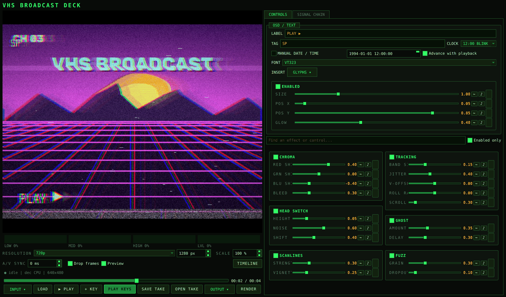
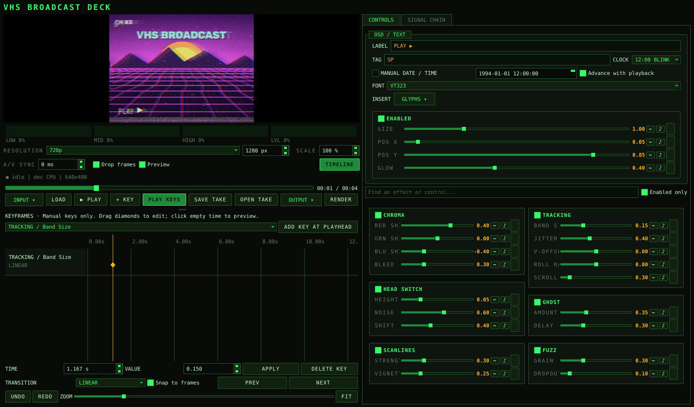
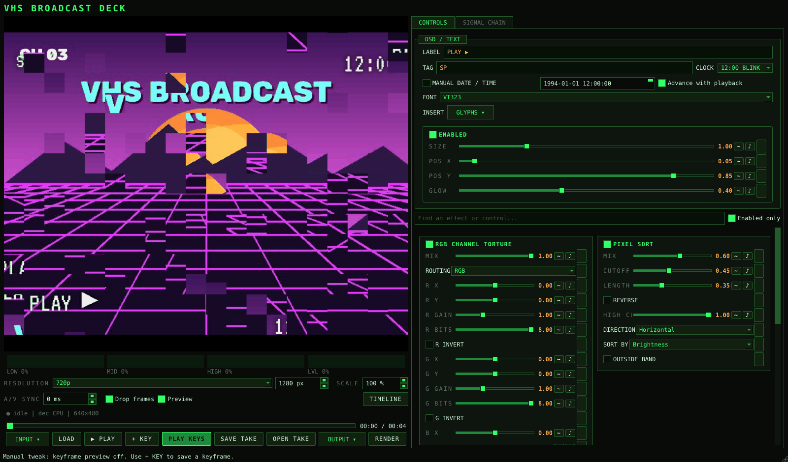
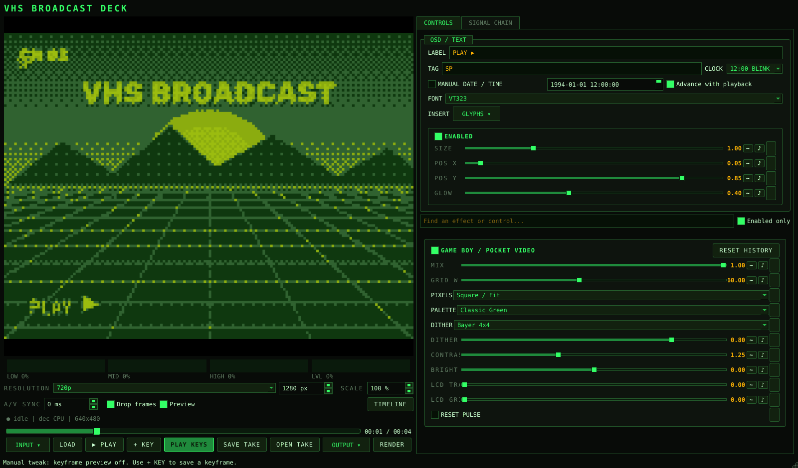
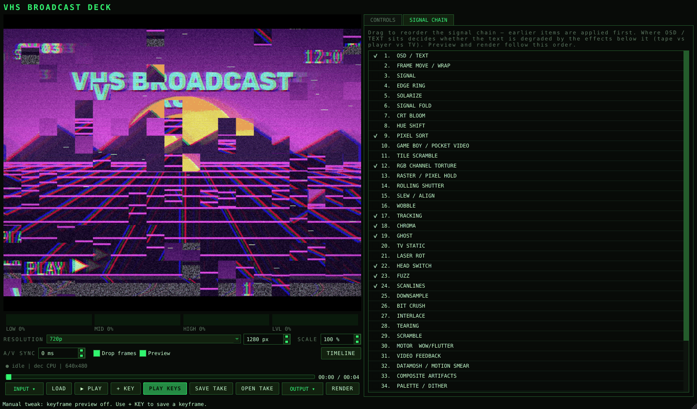

# VHS Broadcast Deck

A desktop video-effects studio for VHS damage, CRT treatments, dithering, pixel
sorting and digital glitches. Tune effects live, drive them from audio, and save
manual keyframes for repeatable file renders. Processing stays local.



**Early release:** Windows is the primary tested platform. File rendering and
headless tests are automated; live devices, audio backends and long editing
sessions still need broader testing. macOS/Linux support depends on available
Qt, codec and capture backends.

## Quick start

Install [uv](https://docs.astral.sh/uv/getting-started/installation/) and Git.
From a terminal:

```sh
git clone https://github.com/LonghornEngineer/VHS-BROADCAST.git
cd VHS-BROADCAST
uv sync --locked
uv run vhs-broadcast
```

Python 3.10 or newer is required; uv can provision a compatible Python when needed.
The first sync downloads dependencies. Subsequent launches use the local environment.
Windows users can also double-click `run.bat`; macOS/Linux users can run `bash run.sh`.
No OpenAI account, AI model, API key or external FFmpeg executable is needed.

1. Click **LOAD** and choose a video (`mp4`, `mov`, `avi`, or `mkv`, subject to codec support).
2. The clip opens paused. Search for an effect, enable it, and adjust its controls.
3. Press **PLAY**. Lower **RESOLUTION** or **SCALE** if preview cannot keep up.
4. **SAVE TAKE** stores your settings in JSON. **RENDER** exports an MP4 using saved keys.

OSD text is enabled by default; turn it off in **OSD / TEXT** for a clean picture.
A take references your source video and any background images; it does not embed them.
Keep those assets with your project when moving it to another computer.

## Keyframes: experiment first, save changes deliberately

**Moving a slider never creates a keyframe.** The timeline sits below the preview.


Drag the divider to resize the two areas, or use **TIMELINE** to hide/show it.

For example, to gradually increase Block Corruption:

1. Enable **BLOCK CORRUPTION**, pause at the beginning, and set **Density** to `0`.
2. Click the diamond beside Density to save that value at the playhead. You can
   also select the control in the timeline and use **ADD KEY AT PLAYHEAD**.
3. Scrub to a later time, set Density to `0.6`, and add another key.
4. Select **LINEAR** for a steady transition or **SMOOTH** for eased movement.
5. Turn on **PLAY KEYS**, return to the beginning, and press Play.

Use a control's **Enabled** track to switch an effect on/off over time. Numeric
tracks support HOLD, LINEAR and SMOOTH; dropdowns and toggles use HOLD.
Interpolation applies to the whole track. The first/last key value extends before/
after its key time, so add an initial zero/off key when an effect should start later.

- Drag a diamond horizontally to move its time and vertically to change its value.
- Use **TIME**, **VALUE**, and **APPLY** for precise edits.
- Use **DELETE KEY**, **UNDO**, **REDO**, **Snap to frames**, **ZOOM**, and **FIT**.
- A key moved onto an existing key replaces it; Undo restores the previous edit.
- **PREV/NEXT** or clicking empty timeline space seeks and previews the keys.
- **+ KEY** opens/focuses the editor; **ADD KEY AT PLAYHEAD** actually inserts a key.

Tweaking a control turns **PLAY KEYS** off so you can audition changes. Existing
keys stay intact. **RENDER always applies the take's keys**, even if preview is off.
Double-click a numeric slider to restore its default; this does not delete keys
or disable its audio/LFO modulation. Live capture has no seekable keyframe timeline.

### Changing OSD text partway through

Text isn't a slider, so it uses **TEXT KEYS** in **OSD / TEXT** instead of the timeline.
Set **LABEL**, **TAG**, **CLOCK** and the manual date the way you want them, move the
playhead, and click **KEY TEXT AT PLAYHEAD**. That snapshot holds until the next text
key; before the first key the fields' own values apply. Pick a key from the list to
jump to it, or **DELETE** it. To change a key, set the fields again and key the same
spot. With **Advance with playback** on, a keyed date counts up from its key time,
so a camcorder date can jump years between scenes. Text keys are saved in the take
and always apply, in preview and render.

The clock and **TAG** each have their own **X / Y** sliders (**Clock X/Y**, **Tag X/Y**)
next to the label's **Pos X/Y**. They're ordinary controls, so they can be keyframed:
for example, keep the date inside a 4:3 area and slide it out to the corner when the
picture opens to 16:9. The clock is anchored by its right edge, the tag by its left.

## Takes: save, reopen and reuse a project

A **take** is a `.json` project file containing the instructions for your look.
It saves effect values and enable switches, signal-chain order, audio/LFO
settings, manual keyframes and interpolation, OSD text/clock/font settings, and
references to the source video and any luma-key background image.

The video itself, background images and font files are not embedded. A take also
does not store the current playhead, timeline undo history, preview resolution/
scale, live-capture connection, virtual-camera state or effects' frame-history
buffers. Choose the processing resolution again when reopening a project.

### Save your work

1. Load your video, build the effect chain and add any desired keys.
2. Click **SAVE TAKE** and choose a name such as `song-v01.json`.
3. After further edits, use **SAVE TAKE** again. Select the same file to update
   it, or use a new name such as `song-v02.json` to keep a variation.

Saving captures your current settings and existing keys; it does not turn slider
experiments into keyframes. Takes work without any keys, too, for a static look
or audio/LFO-driven effects. Save explicitly before closing or opening another
take; there is no autosave or unsaved-changes prompt.

### Reopen and continue editing

1. Click **OPEN TAKE** and select the `.json` file.
2. The app restores its controls, chain and keys, and loads the referenced video
   if it is available. Opening a take replaces the current settings and timeline.
3. If the source moved, choose it in the **Locate missing take video** dialog.
   Cancelling that dialog loads the settings/keys but leaves the current input
   unchanged; use **LOAD** to choose the intended video before rendering.
4. Turn on **PLAY KEYS** to audition the saved animation. Start from the beginning
   when comparing feedback, trails or other effects that need earlier frames.
5. Save again after edits or after locating moved media to update the take.

Opening a take starts with keyframe preview off. Your keys are still present;
**PLAY KEYS** enables them for preview, and **RENDER** always applies them.

### Reuse a look or move it to another computer

To apply a take to another clip, **OPEN TAKE** first, then **LOAD** the new video
and **SAVE TAKE** under a new name. Settings and keys remain; key times are in
seconds and do not automatically stretch to the new clip's duration. Check the
timing and audio response against the new source.

When sharing or moving a project, include its take, source video and any background
images separately. Paths are not automatically made portable. Locate the source
when prompted, reload a missing image using **LOAD BACKGROUND IMAGE** in Luma Key,
and select an available font in **OSD / TEXT**. Install optional fonts separately
under their own terms. Live-input takes restore the look but do not reconnect the
screen, window or capture device; choose that source again from **INPUT**.

### Make a finished video

Use **RENDER** to export an MP4 from a loaded file source. **SAVE TAKE** saves the
editable project; **RENDER** creates the watchable video. Keep both if you want to
revisit the edit later. **OUTPUT → Record Processed Video…** is a separate live,
video-only recording feature and does not create a take or capture slider changes
as keys.

## Audio-reactive controls and movement

Use the music-note button beside a numeric control. Choose a band, then tune
**LOW CUT / HIGH CUT** in Hz. **THRESHOLD** determines activation on the filtered
meter. The main slider is **TARGET**; **REST** is its quiet value, and **RAMP**
sets how quickly it moves between them. LEVEL uses overall loudness rather than
a frequency range. Audio analysis uses loaded file audio, not live microphone input.

The **~** button adds an LFO. Audio and LFO modulation are layered over base/keyed
values; their configuration is saved per control rather than as individual tracks.
Use motion *rates* with Rest `0` to stop in place between audio hits. Direct pan or
position controls jump to their assigned position instead.

## Effects and signal chain

Use the search field or **Enabled only** to find controls. Drag effects in
**SIGNAL CHAIN** to change processing order, including where text is composited.

| Digital damage | Game Boy dither |
| --- | --- |
|  |  |



| Family | Examples |
| --- | --- |
| Tape and analog | Tracking, wobble, chroma, head switching, motor wow/flutter, RF interference |
| CRT and color | Scanlines, bloom, geometry/mask, phosphor persistence, hue shift, solarize |
| Pixel and retro | Palette/dither, line dither, Game Boy video, LED matrix sign, Tile Scramble, pixel sorting, RGB channel controls |
| Digital damage | Block Corruption, Sync Loss, FMV / CD-ROM video, datamosh-style motion smear, raster hold, rolling shutter |
| Composition | Frame Move / Wrap, video feedback, temporal displacement, luma key, OSD |

See the [effect reference](docs/effects.md) for controls and suggested starting points.
Tile Scramble retains the historical `nes_corrupt` ID for take compatibility.
Block Corruption contains the repeated-tile workflow; the separate Dirty Cartridge
experiment was removed.

## Preview, rendering and live output

**RENDER** offers full resolution or your current processing width/scale.
Exports replace the destination only after completion. Cancel stops at a processing
boundary; audio preparation/muxing may finish first. Exporting over the source is blocked.

```sh
uv run vhs-render --session take.json --output output.mp4 --full
```

The simpler `vhs-render` command displays human-readable progress and can overwrite
its output. The agent interface below uses structured results and explicit overwrite.

History effects depend on previously processed frames. Seeking, source/resolution/
chain changes and disabling an effect clear history. Pausing does not add frames.
Dropped frames or jumping into the middle of a take can produce a different trail
from a full export. Compare by playing from the start at the same resolution.
Use **TIMER** or **MANUAL DATE / TIME** for repeatable OSD time, not the wall clock.

**INPUT** offers screen/region, window, or camera/capture-card sources where supported.
**OUTPUT** can send video to a virtual camera or record processed video. These live
outputs are video-only; route audio separately through your streaming software.
Virtual camera requires a compatible backend such as OBS or Linux v4l2loopback.
The standalone GPU effect renderer was removed; hardware video decoding may still be used.

## Use VHS Broadcast as a virtual camera

Send the processed picture from a video file, screen/window capture, or physical
camera into an app that accepts a webcam. Effects run in VHS Broadcast; the other
app receives the resulting video. The Python integration is included by `uv sync`,
but you must install an operating-system virtual-camera backend separately.

### One-time setup

- **Windows:** install [OBS Studio](https://obsproject.com/download), which
  includes the OBS Virtual Camera device. Keep OBS's own virtual-camera output
  stopped while VHS Broadcast is using that device.
- **macOS:** install a compatible OBS version, open OBS, click **Start Virtual
  Camera**, then **Stop Virtual Camera**, and close OBS. Follow any OS approval
  prompts. Check the [pyvirtualcam setup and compatibility notes](https://github.com/letmaik/pyvirtualcam#supported-virtual-cameras)
  for your macOS/OBS versions.
- **Linux:** install and load [v4l2loopback](https://github.com/v4l2loopback/v4l2loopback).
  For example, on Ubuntu:

  ```sh
  sudo apt install v4l2loopback-dkms
  sudo modprobe v4l2loopback devices=1
  ```

  Other distributions may use different packages; follow the upstream instructions
  for kernel support and device permissions. The app uses an available virtual
  camera automatically; it currently has no output-device picker.

### Start streaming the effects

1. In VHS Broadcast, **LOAD** a video or choose a source from **INPUT**.
2. Enable your effects and choose a **RESOLUTION / SCALE** your computer can
   process smoothly. These settings also determine virtual-camera image size.
3. Open **OUTPUT → Virtual Camera** to enable it. The status message identifies
   the device and tells you to press Play.
4. Press **PLAY** to send moving video.
5. In the receiving app's camera/video settings, select **OBS Virtual Camera**
   on Windows/macOS, or the loopback camera on Linux. For example, select it as
   the camera in Zoom or Discord. Restart the receiving app if it was opened
   before the virtual-camera device was installed.
6. To stop sending, uncheck **OUTPUT → Virtual Camera** or close VHS Broadcast.

To bring the result into OBS for recording/streaming, add a **Video Capture
Device** source and select the virtual camera. OBS's built-in camera is a single
device: don't also start OBS's virtual-camera output on that same device. For
more complex routing, see the [upstream backend notes](https://github.com/letmaik/pyvirtualcam#supported-virtual-cameras).

**Audio is separate.** The virtual camera carries video only. Select your microphone
or a separately routed audio source in the receiving app; file-audio playback in
VHS Broadcast does not make it part of the virtual-camera feed.

If the picture is black or frozen, check that an input is loaded and playing,
the correct camera is selected, and another producer isn't occupying the device.
If startup fails, the app displays the backend error. See [OBS's troubleshooting
guide](https://obsproject.com/kb/virtual-camera-troubleshooting) for installation
and camera-visibility issues. Lower processing resolution for stuttering output;
you can also uncheck **Preview** to skip the local display while continuing output.
For consistent results, choose your input and output resolution before enabling
the virtual camera; reconnect the receiving app after changing formats if needed.

Virtual-camera behavior depends on the OS, backend and receiving app. Actual
device testing remains part of the pre-release checklist.

## AI agents and scripting

The local **vhs-agent** CLI is a versioned JSON interface. It does not launch the
GUI or expose a network service. Agents can discover IDs and bounds, create a GUI-
compatible take, validate it, and export a video:

```sh
uv run vhs-agent catalog
uv run vhs-agent create --spec examples/block-glitch.json --output take.json
uv run vhs-agent validate --session take.json
uv run vhs-agent render --session take.json --input clip.mp4 --output output.mp4 --width 1280
```

The example intentionally leaves the source unset; replace `clip.mp4` with your
file. Open the resulting take with **OPEN TAKE**, then **LOAD** that same video to
inspect or edit it. For a self-contained reference to the media, set `source` in
its spec before creation. Take files do not embed media.

See [Agent API](docs/agent-api.md) for the JSON contract, Python functions, errors,
stdin input, modulation settings and keyframe examples. No screen clicking is required.

## Troubleshooting

- **Slow preview:** lower processing resolution/scale; disable expensive pixel-sort,
  optical-flow and history effects until you find the bottleneck. Drop frames keeps
  playback closer to the audio clock; disabling it favors showing every frame.
- **Silent video:** check whether the source contains audio and your output device.
  Live processed recording is deliberately video-only.
- **No capture devices/windows:** backend support and OS capture permissions vary.
  Start with a file to verify the effect pipeline independently.
- **Different export appearance:** match processing resolution, start playback at
  zero for history effects, and check keyframes, modulation, chain order and OSD clock.
- **Missing background/source:** takes store paths. Restore the media or select it again.

## Development and release checks

```sh
uv sync --locked
uv run python -B -m unittest discover -s tests -v
uv build
```

Tests cover effects, manual keyframes, GUI file workflow, take compatibility,
headless export and cancellation. GUI tests run with Qt's offscreen platform.
Before release, test representative full-length videos with audio, actual capture
and virtual-camera devices, and install the built wheel in a fresh environment.
Report issues with OS, Python version, input codec/resolution, enabled effects and
reproduction steps. Do not attach private media or take files without reviewing paths.

## Fonts

These fonts are included and available in the **OSD / TEXT → FONT** dropdown:

- [VT323](https://fonts.google.com/specimen/VT323)
- [Share Tech Mono](https://fonts.google.com/specimen/Share+Tech+Mono)
- [Press Start 2P](https://fonts.google.com/specimen/Press+Start+2P)

Their SIL Open Font License notices ship with the app; see
[third-party notices](THIRD_PARTY_NOTICES.md).

[VCR OSD Mono by Riciery Leal](https://www.dafont.com/vcr-osd-mono.font) is an
optional download with separate terms and is not bundled. For a source checkout,
install a local copy using the prompted helper:

```sh
uv run python scripts/fetch_vcr_font.py
```

Restart the app afterward to see it in the font dropdown. You can also download
the font from the linked page and place its `.ttf` in
`src/vhs_broadcast/assets/fonts/`.

## License and credits

Project code is [MIT licensed](LICENSE). This project was developed with AI
assistance under human direction. That disclosure does not replace the license.
Dependencies and fonts retain their own licenses; see [third-party notices](THIRD_PARTY_NOTICES.md).
